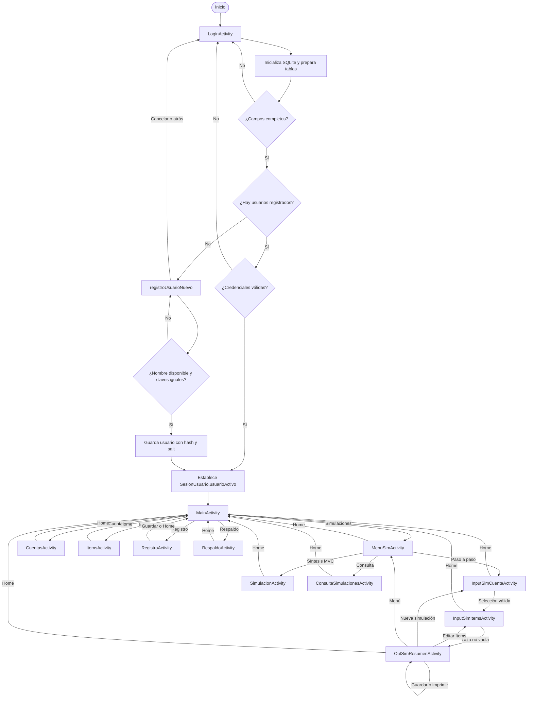
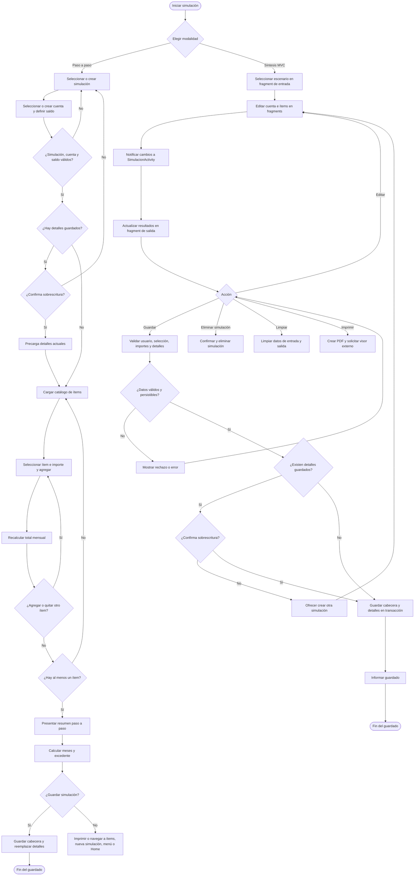
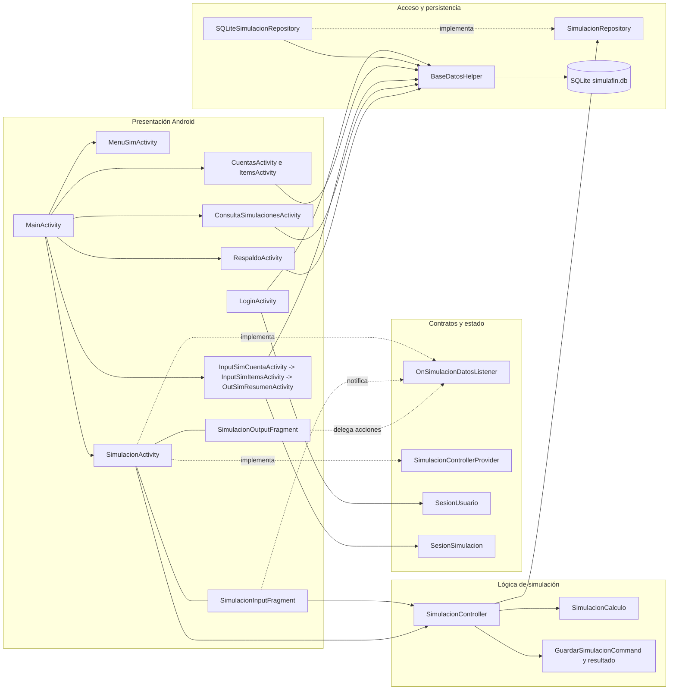
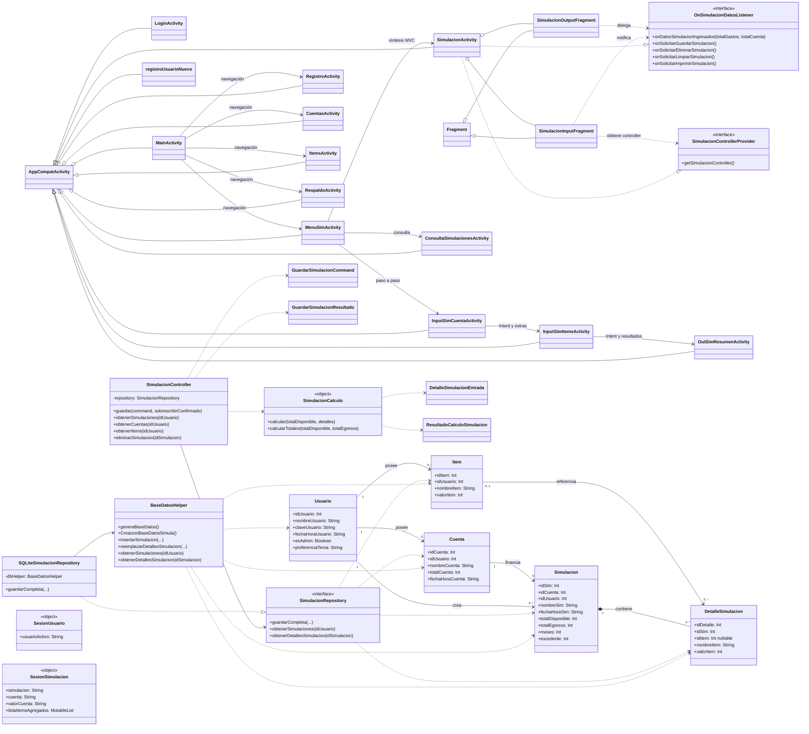
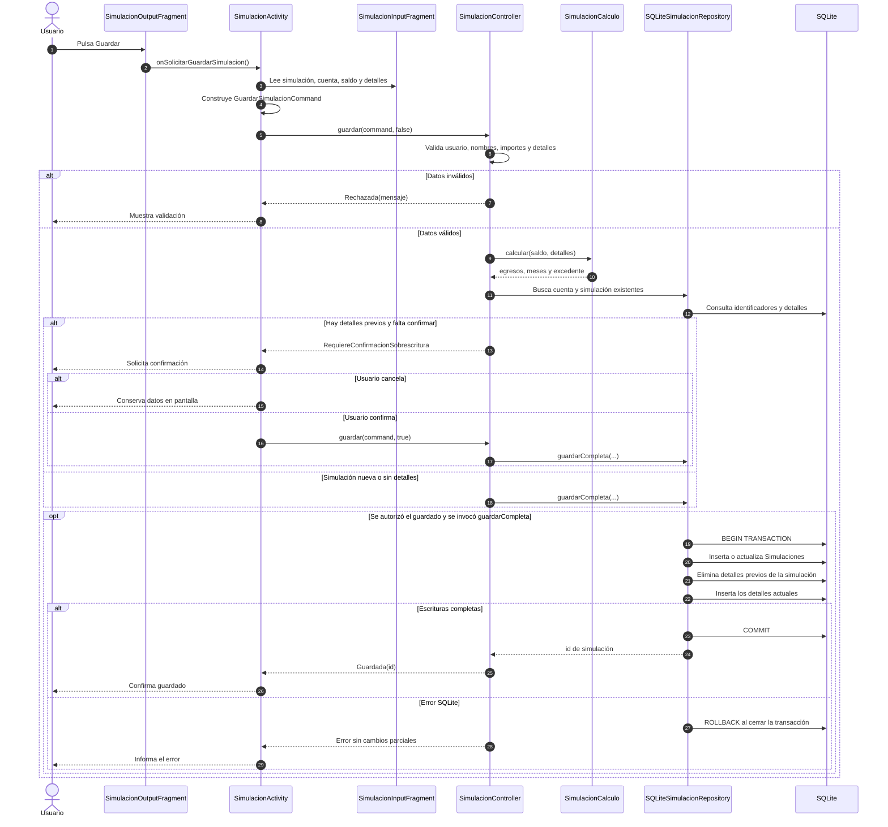
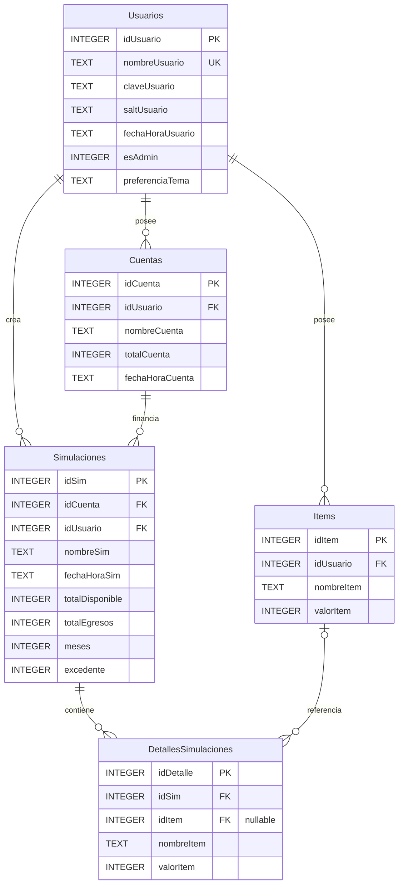

# Diagramación del sistema SimulaFin

**Proyecto analizado:** `SimulaFin_MVC_18OCT`  
**Fecha y hora:** 2026-10-18 14:15:58  
**Alcance:** navegación, actividades, capas, clases del dominio y persistencia existentes. Documento descriptivo; no modifica el código.

> En el workspace no se encontraron `flujoAPPsimulaFin.md` ni `detalleFlujoAppSimulaFIN.txt`. Los diagramas se basan en el código Kotlin y `AndroidManifest.xml` de esta versión.

## 1. Visión general

SimulaFin es una aplicación Android con persistencia local SQLite (`simulafin.db`). El usuario entra mediante `LoginActivity`; la sesión activa se conserva en memoria por `SesionUsuario`. El menú principal lleva a cuentas, ítems, edición de usuario, respaldos y simulaciones.

Hay dos modalidades de simulación:

- **Paso a paso:** Activities enlazadas por Intents, con `BaseDatosHelper` y estado temporal en `SesionSimulacion`.
- **Síntesis interactiva:** `SimulacionActivity` coordina `SimulacionInputFragment` y `SimulacionOutputFragment`; utiliza `SimulacionController`, el contrato `SimulacionRepository`, `SQLiteSimulacionRepository` y el dominio de cálculo.

La base relacional contiene `Usuarios`, `Cuentas`, `Items`, `Simulaciones` y `DetallesSimulaciones`. La app permite generar PDF, exportar consultas a JSON/CSV y operar respaldos locales.

## 2. Navegación global

## 3. Actividad de simulación

El siguiente flujo reúne las dos modalidades y deja visibles las validaciones, las operaciones de cálculo, edición y guardado.

**Cálculo:** el total de egresos suma los valores de los ítems. Si es mayor que cero, `meses = saldo / egresos` usando división entera y `excedente = saldo - meses * egresos`. Con egresos cero, el dominio entrega cero meses y el saldo como excedente; el resumen paso a paso etiqueta la duración como indefinida.

## 4. Arquitectura de componentes

Las Activities de mantenimiento, consulta, respaldo y paso a paso acceden a `BaseDatosHelper` directamente. El patrón Repository y la capa Controller están aplicados principalmente al flujo de síntesis MVC.

## 5. Diagrama de clases UML

## 6. Secuencia de guardado MVC

## 7. Esquema relacional

`idItem` es nullable en `DetallesSimulaciones`; al borrar un ítem relacionado, la clave puede quedar nula y el detalle mantiene nombre y monto. Los nombres de cuenta e ítem son únicos por usuario, y el nombre de simulación también es único por usuario.

## 8. Otros procesos

### Consulta de simulaciones

1. Carga las simulaciones del usuario activo.
2. Al seleccionar una, presenta cuenta, fecha, saldos, egresos, meses, excedente y detalles.
3. JSON y CSV solicitan una ruta antes de escribir el archivo.
4. PDF genera un documento y solicita abrirlo con una aplicación externa.
5. La acción **Enviar** solo muestra un aviso; no transmite información a un servicio externo.

### Respaldo y restauración

1. El respaldo normal copia `simulafin.db` a `simulafin_backup.db` en Descargas o a una ubicación elegida mediante SAF.
2. Restaurar copia un archivo seleccionado sobre la base activa; también se pueden cargar datos de prueba.
3. Vaciar la base pide autorización admin y la recrea preservando al usuario activo como administrador.
4. **Respaldo limpio** vacía primero la base activa y luego copia esa base vacía; no conserva los datos que había antes.

## 9. Componentes declarados en Android

`LoginActivity` es la Activity launcher. El manifiesto declara las demás Activities como no exportadas y un `FileProvider` para compartir/abrir PDF con permiso de lectura. No se incluyen servicios ni backend remoto porque no aparecen en el manifiesto analizado.
